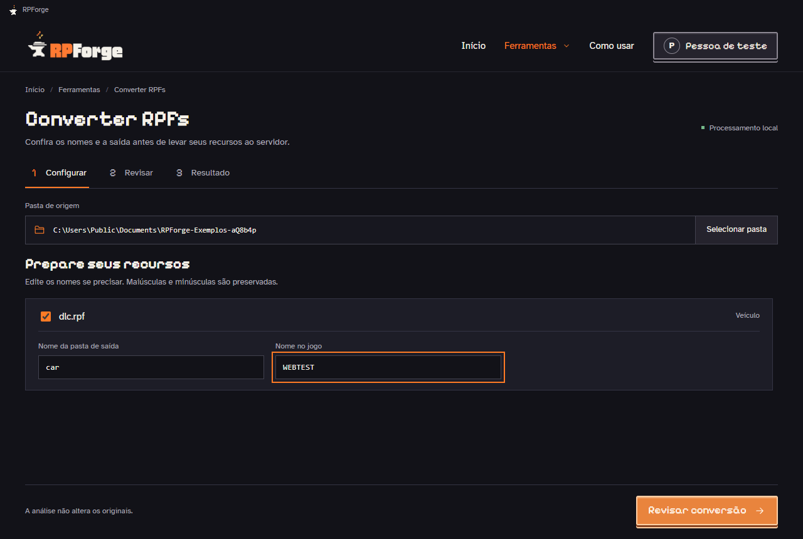
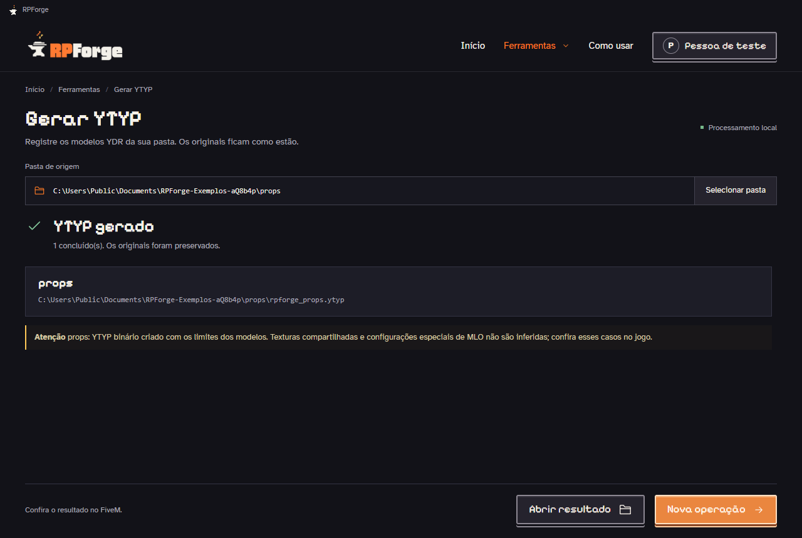

<picture>
  <source media="(prefers-color-scheme: dark)" srcset="docs/guia-usuario/assets/logo-dark.png">
  
</picture>

### Seus pacotes de GTA V, organizados para o FiveM. 🔥

Converta RPFs, altere o spawn dos veículos e gere YTYPs pelo botão direito do Windows. No plano Pro, prepare roupas YDD para OBJ, Neon e separação de pele.

**🪟 Windows 11 · 🚗 GTA V Legacy · 📦 Versão 1.0.1 · 📜 Licença proprietária**

[🌐 Site oficial](https://rpforge.dev/) · [📥 Baixar RPForge](https://rpforge.dev/#download) · [📘 Manual online](https://rpforge.dev/docs/) · [🛠️ Suporte](https://github.com/biancadcastro/RPForge/issues)

---

## ✨ O que o RPForge faz

| Para você que quer… | O RPForge ajuda a… |
| --- | --- |
| 🚗 Adicionar um veículo ao FiveM | Extrair um RPF aberto e criar a pasta do addon com os arquivos organizados. |
| ✏️ Alterar o spawn | Atualizar o nome do veículo e as referências correspondentes. Aceita maiúsculas e minúsculas. |
| 🔧 Organizar o tuning | Colocar peças em `stream/mods` e remover opções visuais sem o modelo necessário no pacote. |
| 🗺️ Converter outros conteúdos | Preparar roupas identificadas, mapas, props, animações, texturas e tipos reconhecidos de peds, armas e áudio. |
| 🧱 Gerar YTYPs | Criar YTYPs básicos a partir de modelos `.ydr`, sem substituir os arquivos que já existem. |
| 👕 Trabalhar roupas (Pro) | Exportar uma peça `.ydd` para OBJ/MTL, criar uma versão Neon emissiva ou separar pele e roupa em YDDs distintos. |
| 🛡️ Conferir antes de gravar | Revisar a saída, decidir como tratar pastas existentes e preservar backups. |

Converter RPFs e gerar YTYPs funciona **sem conta, sem internet, sem terminal e sem instalar Node.js separadamente**. As ferramentas de roupas (Roupas para OBJ, Roupas para Neon e Separar pele) exigem login e uma licença RPForge Pro; o plano Pro é liberado manualmente pela equipe, sem compra pelo app. Seus arquivos não são enviados para um servidor de conversão — a conta só é usada para login e validação da licença.

## 🖼️ Conheça o aplicativo

A interface atual usa Electron + Next.js (`desktop-web/`), com a identidade visual do
site e ações rápidas em janela compacta, e é incluída no instalador. A janela WinForms
antiga (`desktop/`) permanece apenas como alternativa legada. Veja
[arquitetura e execução local](docs/DESKTOP_ARCHITECTURE.md).

### Configure, revise e converta

Os nomes ficam na mesma tela. Se a pasta de saída já existir, você escolhe como continuar.

### Gere YTYPs pelo botão direito

As capturas são do manual 1.0.0 e usam exemplos fictícios. O [manual oficial no site](https://rpforge.dev/docs/) acompanha cada etapa; o [PDF do manual 1.0.0](docs/guia-usuario/Manual-RPForge-1.0.0.pdf) cobre conversão de RPFs, YTYP e conta. O [PDF histórico da 0.3.1](docs/guia-usuario/Manual-RPForge-0.3.1.pdf) permanece como referência dessa edição.

## 🧭 Comece por aqui

1. Baixe e instale o RPForge pelo [site oficial](https://rpforge.dev/#download).
2. Coloque o `.rpf` em uma pasta e clique com o botão direito nela.
3. Escolha **Converter com RPForge**.
4. Em **Configurar**, mantenha os nomes ou edite o spawn.
5. Clique em **Revisar conversão**, confira o resumo e use **Converter agora**.
6. Use **Abrir resultado** e teste o addon no FiveM.

Para YTYP, reúna os `.ydr` em uma pasta e use **Gerar YTYP com RPForge**. A geração começa automaticamente.

Com licença Pro ativa, o botão direito sobre um `.ydd` (ou sobre a pasta) mostra **Exportar para OBJ com RPForge**, **Converter roupa para Neon com RPForge** e **Separar pele com RPForge**. Sem licença Pro, esses comandos ficam ocultos.

### 📥 Instalação

- Instalador: baixe pelo [site oficial](https://rpforge.dev/#download) (`RPForge-Setup-<versão>-x64.exe`). A versão atual do aplicativo é a 1.0.1.
- Pasta padrão: `%LOCALAPPDATA%\Programs\RPForge`.
- Não há atualização automática: para atualizar, baixe e execute o instalador da nova versão.
- A [release 0.3.2](https://github.com/biancadcastro/RPForge/releases/tag/v0.3.2) no GitHub contém somente o instalador EXE daquela versão. O ZIP de código-fonte não acompanha as versões proprietárias.

**Versão de testes com certificado local:** a ativação do menu moderno pede consentimento para confiar no certificado em `TrustedPeople` para todos os usuários e confirmação de administrador. A confiança abrange outros arquivos assinados com a mesma chave. Nenhum certificado raiz é instalado. Sem autorização, o app e o menu clássico continuam disponíveis. A desinstalação não remove automaticamente essa confiança. Alertas do Windows podem continuar aparecendo; a primeira instalação em máquina limpa ainda não foi validada. Leia a [política de assinatura](https://rpforge.dev/docs/assinatura/).

## 📚 Documentação para usuários

| Guia | O que você encontra |
| --- | --- |
| [📘 Manual oficial](https://rpforge.dev/docs/) | Instalação, capturas das telas, tutoriais e dúvidas frequentes. |
| [🪟 Instalação](https://rpforge.dev/docs/instalar/) | Requisitos, confiança local e primeiros passos. |
| [📦 Conteúdos e YTYP](https://rpforge.dev/docs/conteudos/) | Tipos aceitos e limites da conversão. |
| [🛡️ Assinatura local](https://rpforge.dev/docs/assinatura/) | O que o certificado autoriza e as limitações desta versão. |

## 💾 Seus arquivos continuam com você

O RPF original permanece intacto. A análise e a revisão não criam o addon; a gravação começa em **Converter agora**.

Se uma pasta já existir, escolha **Cancelar**, **Usar outro nome** ou **Backup e substituir**. Os backups ficam ao lado da saída. O RPForge não altera seu `server.cfg` nem copia addons para a base de testes automaticamente.

## 🛠️ Precisa de ajuda?

- **O menu não apareceu?** Selecione uma única pasta com `.rpf` ou `.ydr`. Confira também **Mostrar mais opções** no Windows. Os comandos de roupas só aparecem com licença Pro válida; abra o app, entre na sua conta e confira o acesso Pro.
- **Nenhum arquivo foi encontrado?** Escolha a pasta que contém o arquivo. A busca não percorre subpastas do Windows.
- **O RPF foi recusado?** A versão atual aceita GTA V **Legacy**, RPF7 **OPEN/NONE**. Arquivos criptografados e GTA V Enhanced não são aceitos.
- **Converteu, mas o conteúdo não funciona no jogo?** Confira a ativação do recurso, o spawn e as dependências do servidor.

Ao abrir um relato em [Issues](https://github.com/biancadcastro/RPForge/issues), informe a versão do app, o passo em que ocorreu o problema e o texto do erro. Evite anexar conteúdo pago, dados pessoais ou um acervo inteiro.

> 💡 O tamanho em disco não é uma estimativa de FPS ou VRAM. YTYPs básicos não recriam salas e portais de MLO. Teste o resultado no FiveM antes de usar em produção.

## 📜 Licença e privacidade

A partir da **0.3.2**, o código próprio do aplicativo usa [licença proprietária](https://rpforge.dev/docs/licenca/) ([LICENSE](LICENSE): todos os direitos reservados). O uso das ferramentas Free é gratuito; as ferramentas Pro dependem de licença concedida à conta. As dependências mantêm suas próprias licenças.

O código e as versões antigas já disponibilizados neste repositório continuam sob as licenças originais. O histórico público não corresponde ao código atual da versão proprietária e esta mudança não revoga os direitos já concedidos.

Consulte a [política de privacidade](https://rpforge.dev/docs/privacidade/) e os [termos de uso](https://rpforge.dev/docs/termos/). A licença do aplicativo não concede direitos sobre os mods processados.

## 💬 Suporte e sugestões

Use as [Issues](https://github.com/biancadcastro/RPForge/issues) para relatar problemas e sugerir melhorias. Para falhas sensíveis, siga a [política de segurança](SECURITY.md). Não anexe dados pessoais, credenciais ou mods de terceiros sem autorização.

---

**RPForge · por Bianca de Castro** 🧡

Ferramenta independente do RedHorn Studio e do RedHorn Garage. 
Não afiliada à Rockstar Games ou à Cfx.re.

