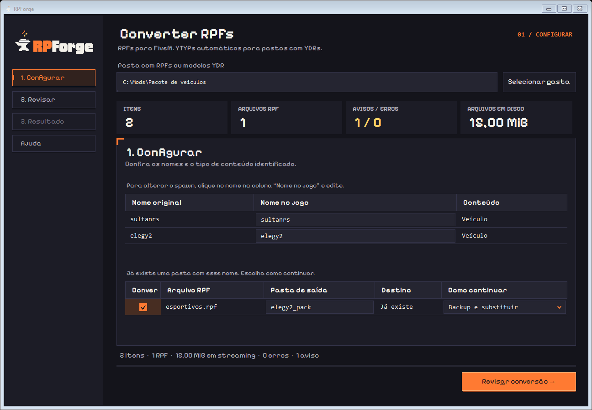
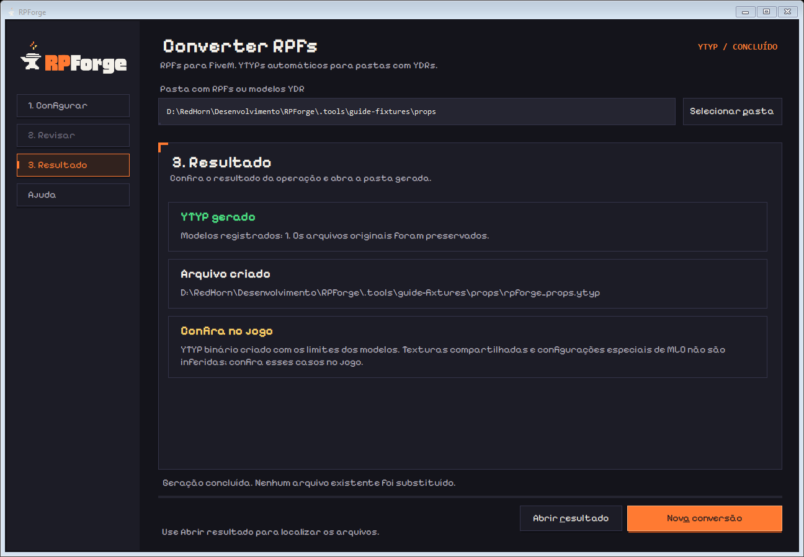

<picture>
  <source media="(prefers-color-scheme: dark)" srcset="docs/guia-usuario/assets/logo-dark.png">
  
</picture>

### Seus pacotes de GTA V, organizados para o FiveM. 🔥

Converta RPFs, altere o spawn dos veículos e gere YTYPs pelo botão direito do Windows.

**🪟 Windows 11 · 🚗 GTA V Legacy · 📦 Versão 0.3.1 · 📖 GPLv3**

[📘 Manual ilustrado](docs/guia-usuario/Manual-RPForge-0.3.1.pdf) · [🧭 Começar a usar](#-comece-por-aqui) · [🛠️ Resolver problemas](#-precisa-de-ajuda)

---

## ✨ O que o RPForge faz

| Para você que quer… | O RPForge ajuda a… |
| --- | --- |
| 🚗 Adicionar um veículo ao FiveM | Extrair um RPF aberto e criar a pasta do addon com os arquivos organizados. |
| ✏️ Alterar o spawn | Atualizar o nome do veículo e as referências correspondentes. Aceita maiúsculas e minúsculas. |
| 🔧 Organizar o tuning | Colocar peças em `stream/mods` e remover opções visuais sem o modelo necessário no pacote. |
| 🗺️ Converter outros conteúdos | Preparar roupas identificadas, mapas, props, animações, texturas e tipos reconhecidos de peds, armas e áudio. |
| 🧱 Gerar YTYPs | Criar YTYPs básicos a partir de modelos `.ydr`, sem substituir os arquivos que já existem. |
| 🛡️ Conferir antes de gravar | Revisar a saída, decidir como tratar pastas existentes e preservar backups. |

O aplicativo funciona **sem login, sem terminal e sem instalar Node.js separadamente**. Seus arquivos não são enviados para um servidor de conversão.

## 🖼️ Conheça o aplicativo

### Configure, revise e converta

Os nomes ficam na mesma tela. Se a pasta de saída já existir, você escolhe como continuar.

### Gere YTYPs pelo botão direito

As capturas são da versão 0.3.1 e usam exemplos fictícios. O [manual em PDF](docs/guia-usuario/Manual-RPForge-0.3.1.pdf) acompanha cada etapa com imagens e instruções.

## 🧭 Comece por aqui

1. Instale o RPForge usando o arquivo fornecido pela equipe.
2. Coloque o `.rpf` em uma pasta e clique com o botão direito nela.
3. Escolha **Converter com RPForge**.
4. Em **Configurar**, mantenha os nomes ou edite o spawn.
5. Clique em **Revisar conversão**, confira o resumo e use **Converter agora**.
6. Use **Abrir resultado** e teste o addon no FiveM.

Para YTYP, reúna os `.ydr` em uma pasta e use **Gerar YTYP com RPForge**. A geração começa automaticamente.

### 📥 Instalação

- Instalador atual: `RPForge-Setup-0.3.1-x64.exe`.
- Pasta padrão: `%LOCALAPPDATA%\Programs\RPForge`.
- O pacote inclui o aplicativo, o runtime e o código-fonte correspondente.

**Distribuição em preparação:** esta é uma edição local de testes. Ainda não há uma release pública nem assinatura de distribuição pela SignPath. Use o instalador fornecido pela equipe; em outro computador, pode ser necessário reconhecer o certificado local de teste com orientação da equipe.

## 📚 Documentação para usuários

| Guia | O que você encontra |
| --- | --- |
| [📘 Manual oficial em PDF](docs/guia-usuario/Manual-RPForge-0.3.1.pdf) | 18 páginas com instalação, capturas das telas, tutoriais e dúvidas frequentes. |
| [🌐 Guia offline em HTML](docs/guia-usuario/index.html) | Navegação por assunto, busca e imagens ampliáveis. Abra o arquivo no navegador após baixar o projeto. |
| [🪟 Fluxo da interface](docs/INTERFACE.md) | Configurar, revisar, converter e encontrar o resultado. |
| [📦 Conteúdos e YTYP](docs/CONTEUDOS_E_YTYP.md) | Tipos aceitos e limites da conversão. |

## 💾 Seus arquivos continuam com você

O RPF original permanece intacto. A análise e a revisão não criam o addon; a gravação começa em **Converter agora**.

Se uma pasta já existir, escolha **Cancelar**, **Usar outro nome** ou **Backup e substituir**. Os backups ficam ao lado da saída. O RPForge não altera seu `server.cfg` nem copia addons para a base de testes automaticamente.

## 🛠️ Precisa de ajuda?

- **O menu não apareceu?** Selecione uma única pasta com `.rpf` ou `.ydr`. Confira também **Mostrar mais opções** no Windows.
- **Nenhum arquivo foi encontrado?** Escolha a pasta que contém o arquivo. A busca não percorre subpastas do Windows.
- **O RPF foi recusado?** A versão atual aceita GTA V **Legacy**, RPF7 **OPEN/NONE**. Arquivos criptografados e GTA V Enhanced não são aceitos.
- **Converteu, mas o conteúdo não funciona no jogo?** Confira a ativação do recurso, o spawn e as dependências do servidor.

Ao abrir um relato em [Issues](https://github.com/biancadcastro/RPForge/issues), informe a versão do app, o passo em que ocorreu o problema e o texto do erro. Evite anexar conteúdo pago, dados pessoais ou um acervo inteiro.

> 💡 O tamanho em disco não é uma estimativa de FPS ou VRAM. YTYPs básicos não recriam salas e portais de MLO. Teste o resultado no FiveM antes de usar em produção.

## 📜 Licença e privacidade

O código próprio do RPForge usa **[GNU GPL versão 3](LICENSE)** (`GPL-3.0-only`). As dependências mantêm suas licenças: veja [avisos de terceiros](THIRD_PARTY_NOTICES.md) e [NOTICE](NOTICE).

Consulte também a [política de privacidade](docs/PRIVACY.md) e a [Code signing policy](docs/CODE_SIGNING_POLICY.md). A licença do aplicativo não concede direitos sobre os mods processados.

🧑‍💻 Contribuir com o projeto

O desenvolvimento é separado do uso do aplicativo. Para trabalhar no código, consulte a [documentação da interface](docs/DESENVOLVIMENTO_INTERFACE.md), o [roteiro de assinatura](docs/SIGNPATH_PREPARATION.md) e as [verificações de build](docs/SIGNPATH_BUILD.md).

Os testes usam arquivos sintéticos. Instaladores e releases são gerados somente mediante solicitação; credenciais, backups pessoais e conteúdo do jogo ficam fora do repositório.

---

**RPForge · por Bianca de Castro** 🧡

Ferramenta independente do RedHorn Studio e do RedHorn Garage. 
Não afiliada à Rockstar Games ou à Cfx.re.

